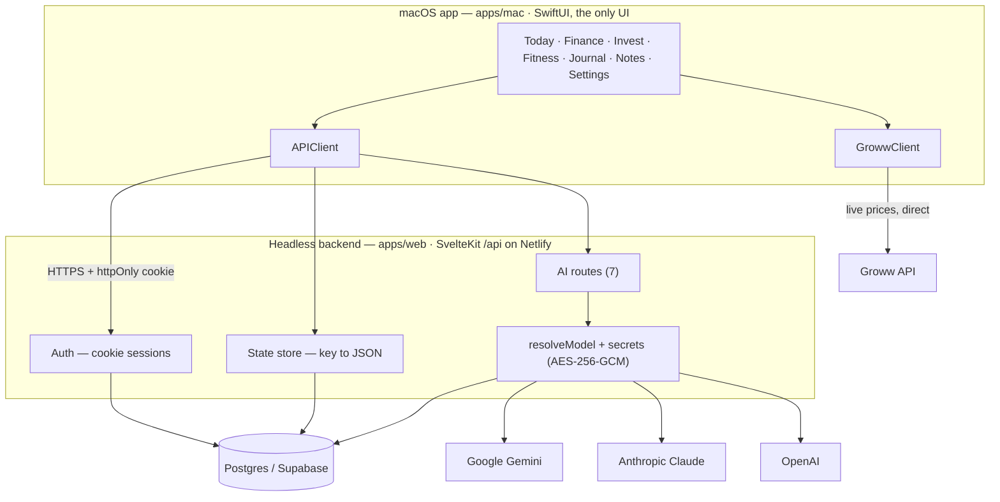
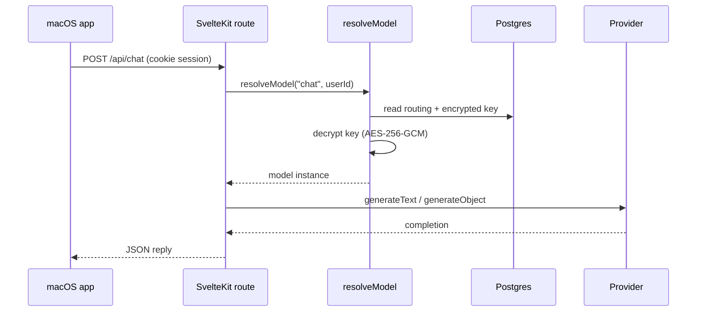

# MyOS — your personal operating system

Your second brain. One app for **money, body, and mind** — and later, everything.

**One product, one backend, native clients on top.** The SvelteKit app in
`apps/web` is a *headless* backend (auth + a per-user `key → JSON` store + AI
routes). The native macOS app in `apps/mac` is the only front-end you touch; it
reads and writes the same JSON keys, so a future iPhone/iPad client stays in sync
for free.

> This is **not** fitOS. fitOS is the commercial gym product. MyOS is personal —
> it reuses fitOS's *architecture* (and some fitness code), nothing else.

## Architecture

The macOS app is the only UI. It talks to the headless backend over HTTPS with an
httpOnly cookie session; the backend owns the database and every AI provider call.
Live market prices are the one exception — the app calls Groww directly.



Postgres holds four tables: `users`, `sessions`, `app_state` (the key→JSON store),
and `ai_credentials` (encrypted provider keys).

## The one idea (same as fitOS)

There is **no per-feature backend.** The server is:

1. **Auth** — username/password → an httpOnly cookie session.
2. **A per-user key→JSON store** — `GET /api/state`, `PUT /api/state/{key}`.
3. **AI helpers** — a handful of stateless routes that read a data snapshot and return structured output.

All app data is JSON documents under string keys:

| Key             | Holds                                                             |
|-----------------|------------------------------------------------------------------|
| `myos.profile`  | name, currency, targets, insurance checklist                     |
| `myos.finance`  | `{ txns: [...], meta: {...} }` — cashflow, gold-loan, emergency fund |
| `myos.fitness`  | per-date weight / calories / protein / water                     |
| `myos.journal`  | per-date morning/night, wins/mistakes/lessons, gratitude, mood   |
| `myos.notes`    | quick-capture notes                                              |
| `myos.days`     | per-date focus priorities + habit ticks (the Today spine)        |
| `myos.ai.routes`| which key + model powers each AI feature                          |

**Add a module = add a key + a view.** The server doesn't change.

## AI — bring your own models

Add your own keys for **Gemini, Claude, or OpenAI** in Settings, then route each
feature to a specific key + model (e.g. Opus 4.8 for chat, Gemini Flash for
analysis). Keys are validated live, stored **encrypted** in the DB, and the routing
syncs across devices. Anything unrouted falls back to the server's env Gemini key,
so the app works with zero setup.



Routable features and the route that serves each:

| Feature              | Route                | Notes                                      |
|----------------------|----------------------|--------------------------------------------|
| Chat                 | `POST /api/chat`     | The floating mentor                        |
| Analysis & advice    | `POST /api/advise`   | Weekly portfolio review                     |
| Screenshot reading   | `POST /api/parse-image` | Transactions / holdings from screenshots |
| Quick logging        | `POST /api/parse`    | One line of life → structured entries       |
| Today suggestions    | `POST /api/suggest`  | "What to do now" nudge                      |
| Plan generation      | `POST /api/plan`     | Weekly workout + meal plan                   |
| News                 | `POST /api/news`     | **Gemini only** — uses Google Search grounding |

Manage keys and routing via `GET/POST /api/ai/keys`, `PATCH/DELETE /api/ai/keys/{id}`,
`POST /api/ai/keys/{id}/check`, and `GET/PUT /api/ai/routes`. The encryption lives in
`apps/web/src/lib/server/secrets.ts`; model listing in `modelCatalog.ts`; resolution
in `ai.ts`.

## Tech stack

**Backend — `apps/web`**

- **SvelteKit 2** on **Svelte 5**, **TypeScript**, Node 20
- **Vercel AI SDK v5** (`ai`) with `@ai-sdk/google`, `@ai-sdk/anthropic`, `@ai-sdk/openai` — one uniform API across providers
- **Zod** for structured-output schemas (`generateObject`)
- **postgres.js** over **Supabase Postgres**
- **AES-256-GCM** via `node:crypto` for provider-key encryption at rest
- **Netlify** deploy (`@sveltejs/adapter-netlify`); `adapter-node` + Vite for local
- **Vitest** for tests

**macOS app — `apps/mac`**

- **Swift 5.9 / SwiftUI**, macOS 14+
- **xcodegen** project generation (`project.yml`)
- `URLSession` client with a shared cookie session; native TextKit block editor
- Duolingo-inspired design system (3D buttons, SF Rounded)

**External services:** Google Gemini, Anthropic, OpenAI (AI); Groww (live prices).

## Run it

```bash
# backend
cd apps/web && npm install && npm run dev      # http://localhost:5173

# mac app (needs xcodegen: brew install xcodegen)
cd apps/mac && xcodegen generate && open MyOS.xcodeproj
```

Or from the repo root: `npm run dev` (backend), `npm run mac:gen && npm run mac:open`.

Point the mac app at your backend by setting the `myos.baseURL` UserDefaults key, or
by editing `APIClient.baseURL` in `apps/mac/Sources/MyOS/Support/APIClient.swift`.

## Secrets / env

Never commit secrets. `apps/web/.env` (gitignored) holds:

| Var                  | Purpose                                                        |
|----------------------|---------------------------------------------------------------|
| `DATABASE_URL`       | Supabase Postgres connection string                           |
| `GEMINI_API_KEY`     | Default Gemini key — the env fallback for all AI routes        |
| `GEMINI_MODEL`       | Default model (use a `-latest` alias; pinned ones get retired) |
| `GEMINI_CHAT_API_KEY` / `GEMINI_CHAT_MODEL` | Optional dedicated key/model for chat          |
| `MYOS_SECRETS_KEY`   | Master key for encrypting user-added provider keys (`openssl rand -base64 32`) |

In production these are Netlify env vars. See `apps/web/.env.example`. If
`MYOS_SECRETS_KEY` is lost or rotated, user-added keys must be re-entered.

## Repo layout

```
apps/
  web/    Headless SvelteKit /api — auth, key→JSON state store, AI routes. Netlify + Supabase.
  mac/    Native macOS SwiftUI app. The only UI. Talks to apps/web's /api/*.
docs/     Design specs.
scripts/  Local backend launch agent (launchd).
```

## v1 scope

Daily spine (Today) + **Finance**, **Invest**, **Fitness**, **Journal**, **Notes**,
AI quick-log, and bring-your-own AI models. Everything else in the PRD (Content Hub,
Knowledge Vault, Goals, Tasks, Reading, Documents, Analytics) is Phase 2.
